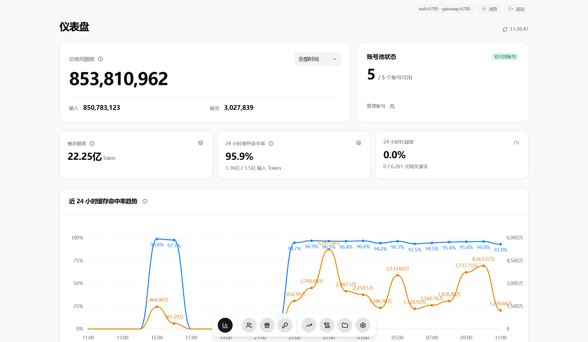
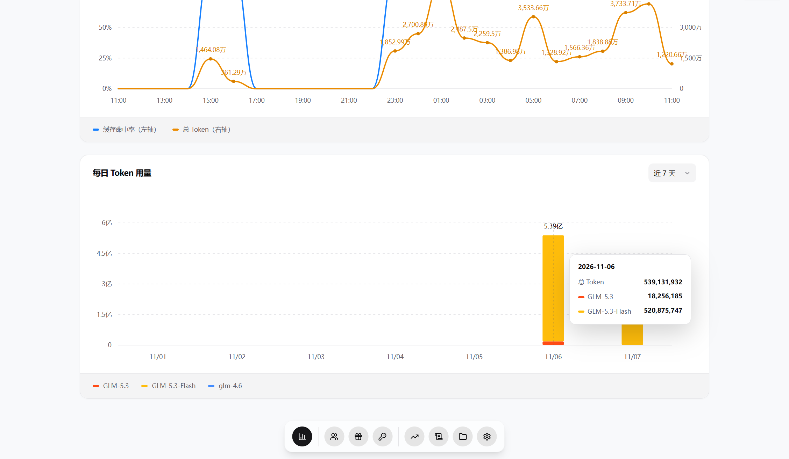
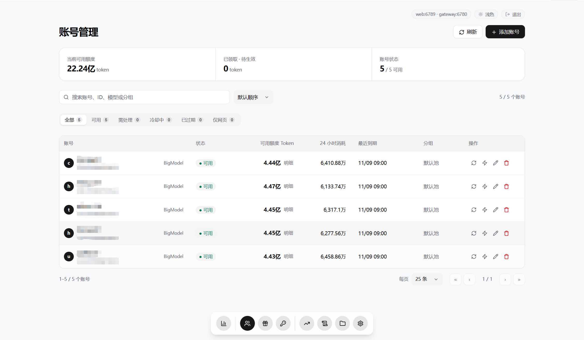
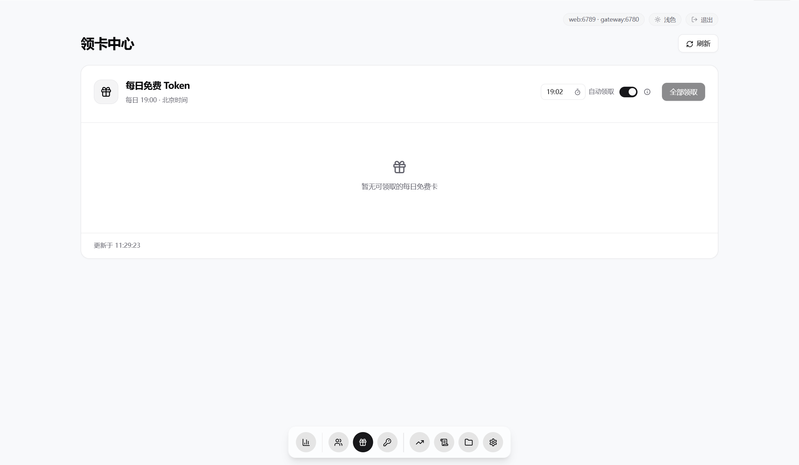
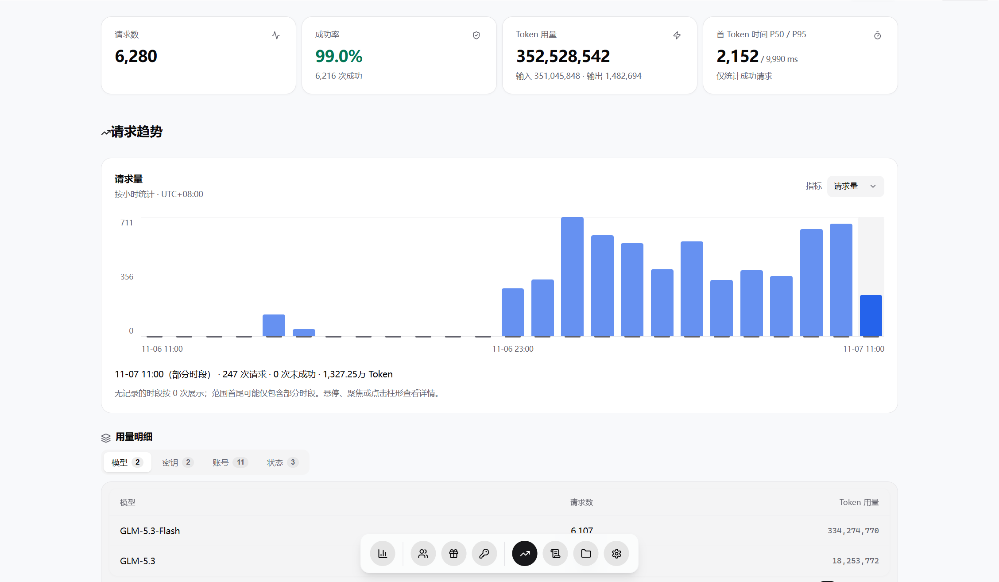
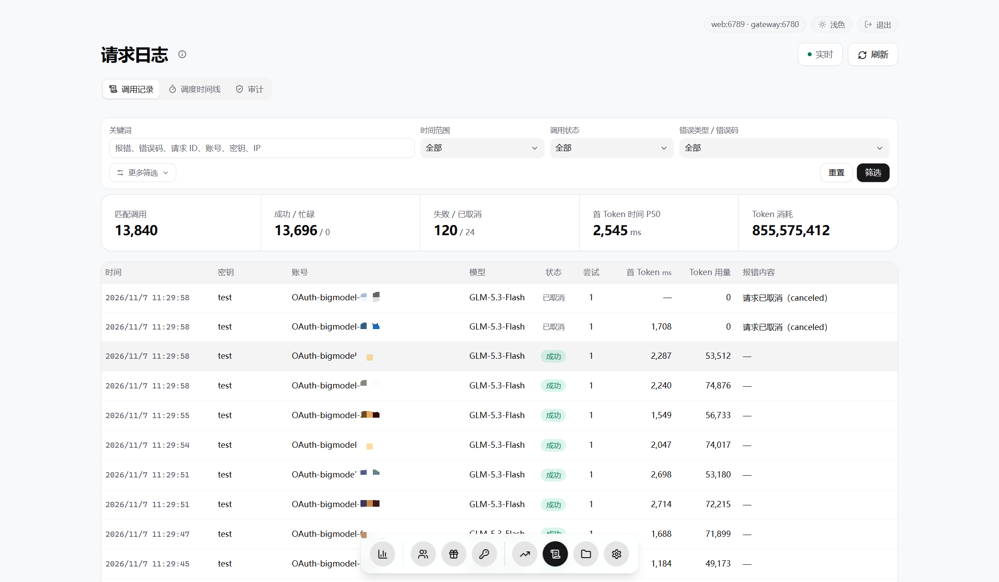
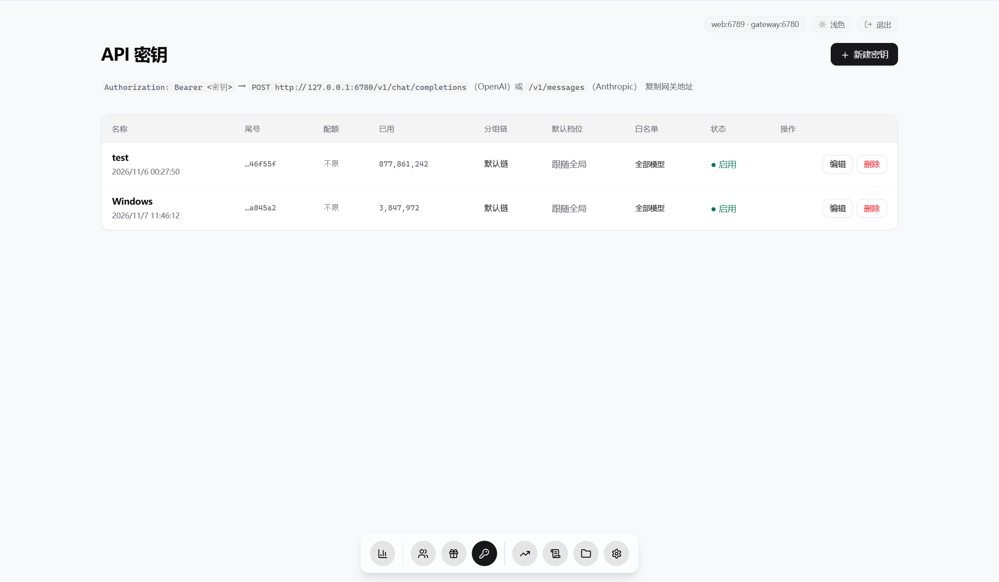
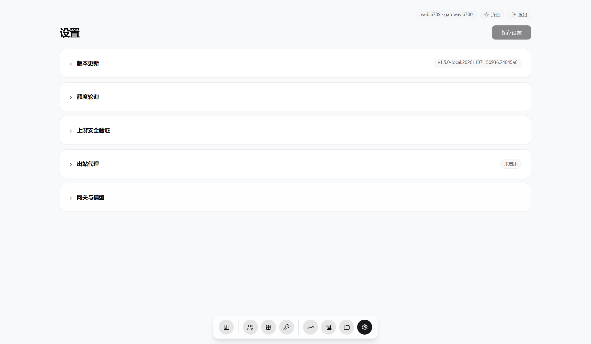

<div align="center">


# zcode2api

[简体中文](README.md) · English · [日本語](README.JP.md)

**A ZCode (Zhipu / Zai) “毒鸡蛋” reverse proxy. Let the gateway handle retries, card claims and multi-account management for free accounts.**

[](https://go.dev/)
[](#quick-start)
[](#quick-start)
[](LICENSE)

[Screenshots](#screenshots) · [Quick start](#quick-start) · [Client setup](#client-setup) · [Configuration (Chinese)](docs/configuration.md) · [Changelog (Chinese)](CHANGELOG.md)

</div>

A reverse proxy gateway for ZCode free accounts, supporting OpenAI Chat Completions, Responses and Anthropic Messages protocols.

Handles Alibaba Cloud's invisible CAPTCHA SDK integration and risk-control errors through isolated single-use tickets, on-demand prefetching and replacement of expired tickets, consistent server egress, error classification and retry cooldowns. Includes account scheduling, automatic card claims and fallback to the official interactive verification widget. Verification outcomes are determined by the upstream service.

## Screenshots

<table>
  <tr>
    <td width="50%" align="center"><br>Dashboard 1</td>
    <td width="50%" align="center"><br>Dashboard 2</td>
  </tr>
  <tr>
    <td width="50%" align="center"><br>Accounts</td>
    <td width="50%" align="center"><br>Card claims</td>
  </tr>
  <tr>
    <td width="50%" align="center"><br>Usage</td>
    <td width="50%" align="center"><br>Logs</td>
  </tr>
  <tr>
    <td width="50%" align="center"><br>API keys</td>
    <td width="50%" align="center"><br>Settings</td>
  </tr>
</table>

## Quick start

### Run from source

Requires Git and Go 1.26+.

```sh
git clone https://github.com/7sen1ot/zcode2api.git
cd zcode2api
go run . --root .
```

### Prebuilt binaries

Download the full archive for your OS and architecture from [Releases](https://github.com/7sen1ot/zcode2api/releases), extract it and run from its root directory. Go is not required.

Windows (PowerShell):

```powershell
.\zcode2api.exe --root .
```

Linux / macOS:

```sh
chmod +x ./zcode2api
./zcode2api --root .
```

### Windows scripts

Run from the root of a source checkout or a full Windows release to start in the background. Source checkouts require Go 1.26+; the script builds the executable automatically.

```powershell
.\scripts\start.ps1
```

To stop, run `.\scripts\stop.ps1`.

### Docker Compose

Requires Git and Docker Compose. This build includes Node.js and jsdom for automatic CAPTCHA verification.

```sh
git clone https://github.com/7sen1ot/zcode2api.git
cd zcode2api
docker compose build --build-arg CAPTCHA_RUNTIME=1
docker compose up -d
```

### Access and configuration

For automatic CAPTCHA verification when using source, binaries or Windows scripts, install Node.js 18+ and run this from the project or extracted release root:

```sh
npm --prefix captcha_node ci --omit=dev --ignore-scripts
```

Open the console at [http://127.0.0.1:6789](http://127.0.0.1:6789). The default admin password is in `data/admin-password.txt`. Keep the `data/` directory: it stores accounts, settings and logs.

For local deployments, copy `config.example.json` to `config.json` to customize settings. For container configuration, see the [configuration guide (Chinese)](docs/configuration.md).

## Client setup

1. Add an account in the console and complete OAuth authorization.
2. Create a gateway API key under **密钥** (Keys).
3. Configure your client:

| Setting | Value |
| --- | --- |
| OpenAI Base URL | `http://127.0.0.1:6780/v1` |
| Anthropic Base URL | `http://127.0.0.1:6780` |
| API key | The gateway key created in the console |
| Model | For example, `glm-flash`; see `/v1/models` for available models |

Example request; replace `YOUR_API_KEY` with your gateway key:

```sh
curl http://127.0.0.1:6780/v1/chat/completions \
  -H "Authorization: Bearer YOUR_API_KEY" \
  -H "Content-Type: application/json" \
  -d '{"model":"glm-flash","messages":[{"role":"user","content":"Hello"}]}'
```

## Documentation

[Configuration (Chinese)](docs/configuration.md) · [Proxies and verification (Chinese)](docs/network.md) · [Changelog (Chinese)](CHANGELOG.md) · [Security (Chinese)](SECURITY.md) · [Apache 2.0](LICENSE)

This is an unofficial project, unaffiliated with ZCode, Zhipu or Z.ai.
