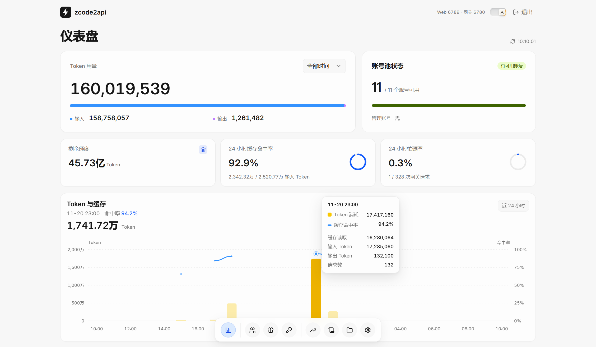
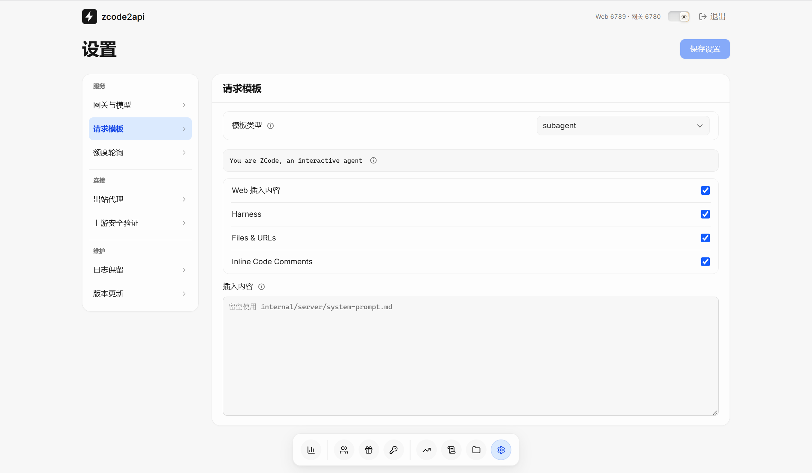

<div align="center">


# zcode2api

[简体中文](README.md) · English · [日本語](README.JP.md)

**A ZCode (Zhipu / Zai) “毒鸡蛋” reverse proxy. Let the gateway handle retries, card claims and multi-account management for free accounts.**

[](https://go.dev/)
[](#quick-start)
[](#quick-start)
[](LICENSE)

[Screenshots](#screenshots) · [Quick start](#quick-start) · [Client setup](#client-setup) · [Configuration (Chinese)](docs/configuration.md) · [Changelog (Chinese)](CHANGELOG.md) · [Disclaimer (Chinese)](SECURITY.md)

</div>

zcode2api is a reverse proxy gateway for free ZCode accounts. It supports multi-account scheduling and automatic card claims, and works with OpenAI Chat Completions, OpenAI Responses and Anthropic Messages (recommended).

In the console, select `subagent` under **设置 → 请求模板** (Settings → Request Templates). The gateway switches to a subagent system template that omits the network security guidance from ZCode's default template. To add a custom prompt to forwarded requests, enable **Web 插入内容** (Insert Prompt), enter the prompt and save.

## Screenshots

<table>
  <tr>
    <td width="50%"></td>
    <td width="50%"></td>
  </tr>
</table>

### `subagent` request examples

Prompt changes apply to client requests forwarded by the gateway. The upstream service independently handles content moderation, risk controls and account enforcement. Follow the provider's terms of service. Abuse may lead to an account ban, and users are responsible for the consequences.

<table>
  <tr>
    <td width="50%"></td>
    <td width="50%"></td>
  </tr>
</table>

## Quick start

| Method | Go required? | Notes |
| --- | --- | --- |
| Full release package | No | Download, extract and run the prebuilt application |
| Run from source (Windows / Linux / macOS) | Go 1.26+ | The Windows startup script builds the source automatically |
| Docker Compose | No | Requires Docker Compose; Docker handles building and running |

### Prebuilt binaries

Download the full release package for your platform from [Releases](https://github.com/7sen1ot/zcode2api/releases) (not `Source code`), extract it and run from its root directory:

Windows (PowerShell):

```powershell
.\zcode2api.exe --root .
```

Linux / macOS:

```sh
chmod +x ./zcode2api
./zcode2api --root .
```

### Run from source

Install Go 1.26+ and get the source with Git, or download and extract **Code → Download ZIP**:

```sh
git clone https://github.com/7sen1ot/zcode2api.git
cd zcode2api
```

On Windows, use PowerShell in the project root to build automatically and run in the background:

```powershell
powershell -NoProfile -ExecutionPolicy Bypass -File .\scripts\start.ps1  # Start
powershell -NoProfile -ExecutionPolicy Bypass -File .\scripts\stop.ps1   # Stop
```

On any platform, use `go run . --root .` to run in the foreground; press `Ctrl+C` to stop.

### Docker Compose

Install Docker Compose, get the source and run from the project root:

```sh
docker compose build
docker compose up -d
```

For SDK verification, see [Docker verification runtime (Chinese)](docs/network.md#docker). Add `--build-arg PROXY_RUNTIME=1` for subscription-based proxy nodes or `--build-arg GRAMMAR_RUNTIME=1` for grammar validation.

### Access and configuration

Console: [http://127.0.0.1:6789](http://127.0.0.1:6789). The default admin password is in `data/admin-password.txt`. Keep the `data/` directory, which stores accounts, settings and logs.

Configure settings in the web console, or copy `config.example.json` to `config.json`. Web console settings take precedence.

## Client setup

1. Add an account under **账号** (Accounts) in the console and complete OAuth authorization.
2. Create a gateway API key under **密钥** (Keys).
3. Configure your client:

| Setting | Value |
| --- | --- |
| OpenAI Base URL | `http://127.0.0.1:6780/v1` |
| Anthropic Base URL | `http://127.0.0.1:6780` |
| API key | The gateway key created in the console |
| Model | For example, `glm-flash`; see `/v1/models` for available models |

Example request; replace `YOUR_API_KEY` with your gateway key:

```sh
curl http://127.0.0.1:6780/v1/chat/completions \
  -H "Authorization: Bearer YOUR_API_KEY" \
  -H "Content-Type: application/json" \
  -d '{"model":"glm-flash","messages":[{"role":"user","content":"Hello"}]}'
```

## Detailed documentation

| Document | Contents |
| --- | --- |
| [Configuration and retries (Chinese)](docs/configuration.md) | Parameters and environment variables, version updates, quota refresh, scheduled card claims, scheduling and logs |
| [Proxies and security verification (Chinese)](docs/network.md) | Node selection and failover, [SDK verification](docs/network.md#安全验证), ticket management, manual verification and [error codes](docs/network.md#故障排查) |
| [Protocol compatibility (Chinese)](docs/protocol-compatibility.md) | Tool calls, grammar validation, system prompt deduplication and instruction conversion limitations |

## References

- The frontend UI draws on [workbuddy-manager](https://github.com/ithtelab/workbuddy-manager), [Leibox](https://leibox.pantoria.cn/components) and [Board UI](https://www.boardui.com/zh-hans/components).
- The built-in jailbreak prompt draws on [kimik3.1.md](https://github.com/togg53192-cmd/jailbreaks/blob/main/Moonshot%20AI/kimik3.1.md) and [《巴别语》 by 洺熙师傅](https://mp.weixin.qq.com/s/WQohsXHbB8dUJisEpfm22g).

## Contributing

You are welcome to report problems and suggest improvements through **Issues**, or help develop and improve the project through **Pull Requests (PRs)**.

**How to contribute:**

1. **Fork** this repository and create a new development branch.
2. **Commit your changes**, keeping the code clear and consistent with the project's conventions. Add explanations where needed.
3. **Open a PR**, describe your changes and their purpose, and wait for review and merging.

Whether you fix a bug, improve a feature or update the documentation, every contribution is appreciated.

If this project helps you, consider giving it a **Star** to support its continued maintenance and development!

## Security and disclaimer

This is an unofficial project with no affiliation with or endorsement from ZCode, Zhipu, Z.ai or BigModel. Only connect accounts you own or are explicitly authorized to use, and comply with the third-party service terms.

The data directory contains the database, master key, admin password and potentially plaintext cookies. Restrict access and keep secure backups.

Upstream APIs, promotions, quotas and account restrictions may change. Retries and SDK verification do not guarantee successful requests. This project is open source under the [Apache License 2.0](LICENSE) and the software is provided “AS IS”. Warranty disclaimers and limitations of liability are subject to Sections 7 and 8 of the license and applicable law. See the [full disclaimer (Chinese)](SECURITY.md).
