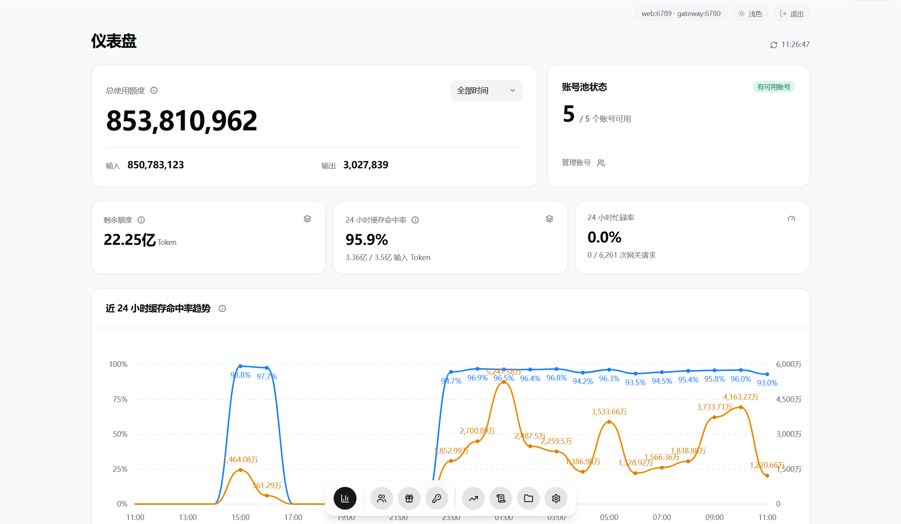
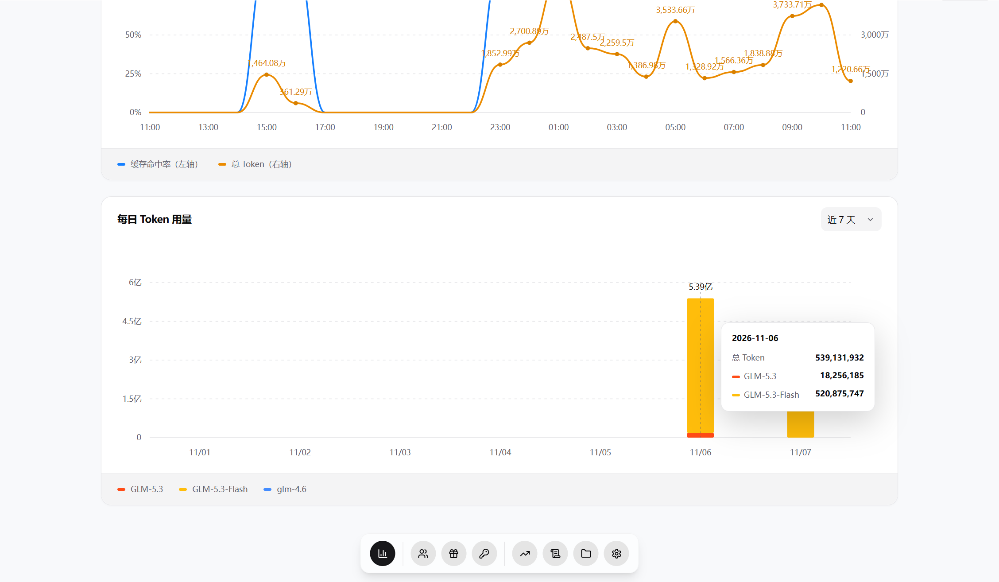
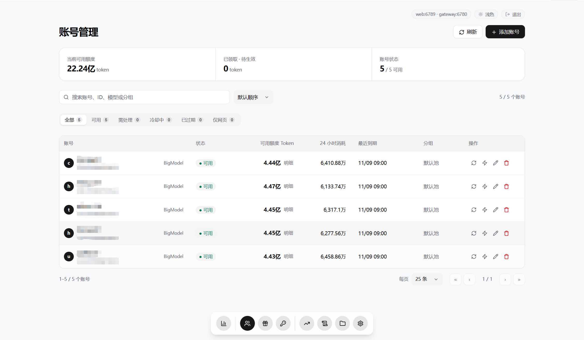
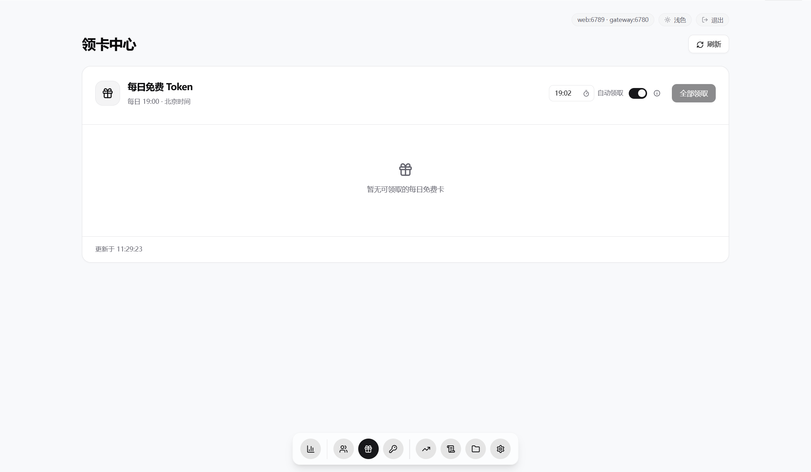
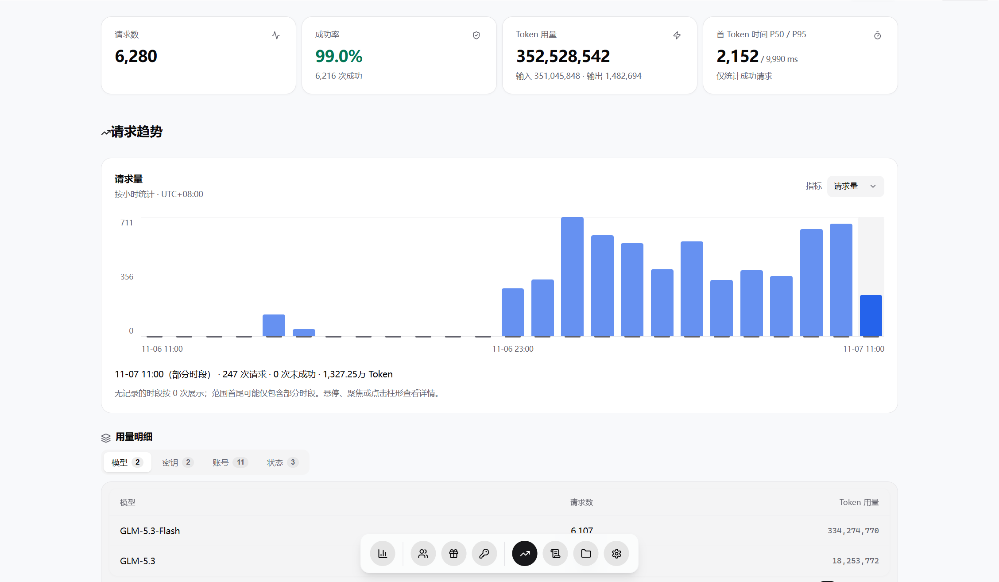
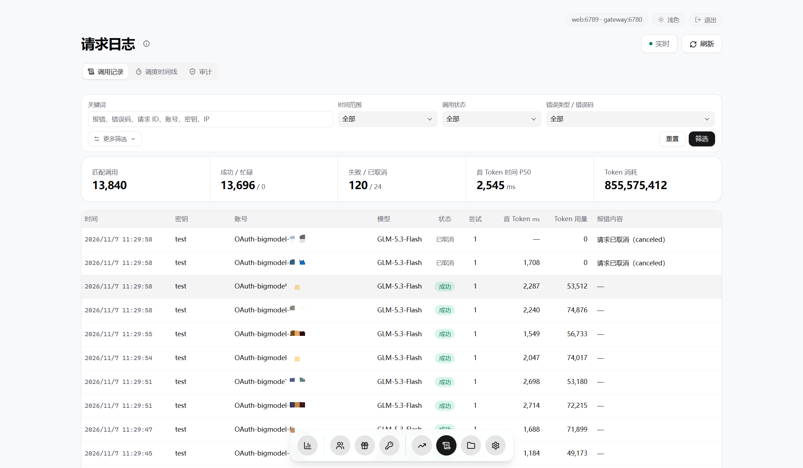
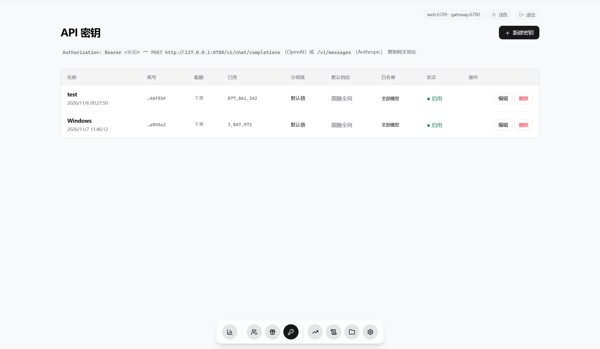
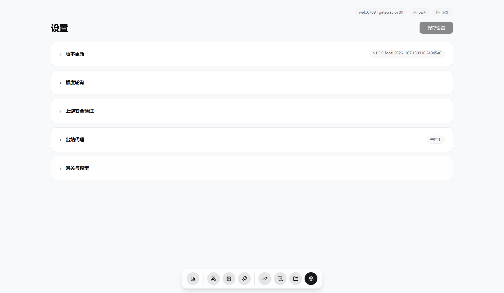

<div align="center">


# zcode2api

[简体中文](README.md) · [English](README.EN.md) · 日本語

**ZCode（智谱・Zai）「毒鸡蛋」リバースプロキシ。無料アカウントのリトライ、カード取得、複数アカウント管理をゲートウェイに任せられます。**

[](https://go.dev/)
[](#クイックスタート)
[](#クイックスタート)
[](LICENSE)

[スクリーンショット](#スクリーンショット) · [クイックスタート](#クイックスタート) · [クライアント設定](#クライアント設定) · [設定ガイド（中国語）](docs/configuration.md) · [変更履歴（中国語）](CHANGELOG.md) · [免責事項（中国語）](SECURITY.md)

</div>

ZCode の無料アカウント向けリバースプロキシゲートウェイです。OpenAI Chat Completions、Responses、Anthropic Messages（推奨）の各プロトコルに対応しています。

Alibaba Cloud の不可視 CAPTCHA SDK の連携とリスク判定時のエラー処理に対応します。使い捨てチケットの分離、必要に応じた事前取得と期限切れ時の補充、サーバーの接続経路の統一、エラー分類とクールダウン付きリトライを実装しています。複数アカウントの振り分け、カードの自動取得、公式の対話型認証への切り替えにも対応します。認証の成否は上流サービスが決定します。

## スクリーンショット

<table>
  <tr>
    <td width="50%" align="center"><br>ダッシュボード1</td>
    <td width="50%" align="center"><br>ダッシュボード2</td>
  </tr>
  <tr>
    <td width="50%" align="center"><br>アカウント管理</td>
    <td width="50%" align="center"><br>カード取得</td>
  </tr>
  <tr>
    <td width="50%" align="center"><br>使用量</td>
    <td width="50%" align="center"><br>ログ</td>
  </tr>
  <tr>
    <td width="50%" align="center"><br>API キー</td>
    <td width="50%" align="center"><br>設定</td>
  </tr>
</table>

## クイックスタート

### ビルド済み実行ファイル

[Releases](https://github.com/7sen1ot/zcode2api/releases) から OS とアーキテクチャに合う完全なアーカイブをダウンロードし、展開先のルートで実行します。Go のインストールは不要です。

Windows（PowerShell）：

```powershell
.\zcode2api.exe --root .
```

Linux / macOS：

```sh
chmod +x ./zcode2api
./zcode2api --root .
```

### ソースから実行

Git と Go 1.26+ が必要です。

```sh
git clone https://github.com/7sen1ot/zcode2api.git
cd zcode2api
go run . --root .
```

Windows のソースまたは完全なリリースパッケージでは、`.\scripts\start.ps1` でバックグラウンド起動、`.\scripts\stop.ps1` で停止できます。ソースから起動する場合は自動ビルドされます。

### Docker Compose

Git と Docker Compose が必要です。以下のビルドには、CAPTCHA の自動検証に必要な Node.js と jsdom が含まれます。

```sh
git clone https://github.com/7sen1ot/zcode2api.git
cd zcode2api
docker compose build --build-arg CAPTCHA_RUNTIME=1
docker compose up -d
```

ノードのサブスクリプションを使うプロキシには `--build-arg PROXY_RUNTIME=1`、custom ツールの grammar 検証には `--build-arg GRAMMAR_RUNTIME=1` を必要に応じて追加してください。

### アクセスと設定

プログラムを直接実行し、サーバー側の自動検証を利用する場合は、Node.js 18+ をインストールしたうえで、プロジェクトまたは展開先のルートで jsdom をインストールしてください。

```sh
npm --prefix captcha_node ci --omit=dev --ignore-scripts
```

管理画面 [http://127.0.0.1:6789](http://127.0.0.1:6789) を開きます。初期管理パスワードは `data/admin-password.txt` に保存されます。アカウント、設定、ログを保存する `data/` ディレクトリは保持してください。

実行時の設定は管理画面から変更するか、`config.example.json` を `config.json` にコピーして指定できます。管理画面で保存した設定が優先されます。

## クライアント設定

1. 管理画面の「账号」（アカウント）でアカウントを追加し、OAuth 認証を完了します。
2. 「密钥」でゲートウェイの API キーを作成します。
3. クライアントに以下を設定します。

| 項目 | 値 |
| --- | --- |
| OpenAI Base URL | `http://127.0.0.1:6780/v1` |
| Anthropic Base URL | `http://127.0.0.1:6780` |
| API キー | 管理画面で作成したゲートウェイのキー |
| モデル | 例：`glm-flash`。利用可能なモデルは `/v1/models` を参照 |

リクエスト例。`YOUR_API_KEY` をゲートウェイのキーに置き換えてください。

```sh
curl http://127.0.0.1:6780/v1/chat/completions \
  -H "Authorization: Bearer YOUR_API_KEY" \
  -H "Content-Type: application/json" \
  -d '{"model":"glm-flash","messages":[{"role":"user","content":"こんにちは"}]}'
```

## SDK 検証

### SDK 検証

サーバーは Node.js 18+ と jsdom を使って Alibaba Cloud の公式 SDK を実行します。Chrome は不要です。依存関係のインストールは[アクセスと設定](#アクセスと設定)を参照してください。「设置 → 上游安全验证」（設定 → 上流のセキュリティ検証）で推論時の検証ポリシーを選択し、保存します。

| ポリシー | 動作 |
| --- | --- |
| `off`（デフォルト） | 推論時に検証 SDK を実行しません |
| `auto`（推奨） | 上流の検証シーンの有効化・検証免除設定に従い、検証が明示的に要求された場合にチケットを取得します |
| `always` | 上流で検証シーンが有効な場合、推論リクエストのたびに事前にチケットを取得します |

推論の検証を有効にしている場合、チケットが失効し、まだ出力を送信していなければ、同じ接続経路で一度だけ再検証できます。本文、思考内容、ツール呼び出しをすでに出力した場合は、リクエスト全体を再送しません。

## ログのエラー説明

呼び出しログの `error_message` は中国語の分類別要約、`error_code` は具体的なエラーコードです。

| エラーコード / メッセージ | 意味と対処方法 |
| --- | --- |
| `upstream_waf_blocked` | 上流のセキュリティゲートウェイによる明示的なブロックです。現在の出口をクールダウンし、利用可能な予備ノードがあればプロキシを切り替えます |
| `proxy_connection_failed` / `proxy_auth_failed` | プロキシへの接続または認証に失敗しました。アドレス、稼働状況、認証情報を確認してください。プロキシプール使用時はノードを一時的に隔離します |
| `proxy_pool_exhausted` / `proxy_upstream_blocked` | 利用可能なプロキシノードがないか、上流のブロックによる出口のクールダウンが続いています。ノードを確認するか、クールダウン終了を待ってください |
| `3012` / `upstream_risk_blocked` | アカウント単位のリスク判定による拒否として扱います。このリクエストでは別の利用可能なアカウントを使用できます。これを理由にプロキシを除外したり、アカウントを自動無効化したりはしません。永久停止の根拠にもなりません |
| `3008` / `3009` / `3010` | 上流アカウントの同時実行枠が一時的に埋まっています。別の利用可能なアカウントを優先し、空きがなければキューで待機します |
| `account_busy` | ゲートウェイがアカウントの空き枠を待つ間にタイムアウトしました。アカウント数、同時実行の使用状況、キューの待機時間を確認してください |
| `rate_limit_error` / リクエスト頻度制限 | 上流のレート制限です。指定された待機時間とリトライ可能期間に従ってください。プロキシの故障とは判断しません |
| `authentication_error` / `insufficient_quota` | それぞれ上流アカウントの認証情報の失効、利用枠の不足を示します。再認証するか、利用可能な枠を確保してください。このリクエストでは別の利用可能なアカウントを使用できます |
| `coding_plan_security_verification_required`、または明確な検証要求を伴う `3007` | 上流がセキュリティ検証を要求しています。対応する SDK または手動検証の手順に進んでください。`3007` はメッセージと合わせて判断し、一律に CAPTCHA の問題とは扱いません |
| `captcha_risk_blocked` / `F001` | SDK のリスク判定による拒否です。アカウントやプロキシが無効である根拠にはならず、プロキシノードの切り替えも行いません |
| `F010` / `F011` | それぞれ SDK の出口単位、デバイス単位のアクセス頻度制限です。対応する範囲でクールダウンします |
| `captcha_expired`、`F019`、`F008`、`F018` | 検証チケットの失効または重複送信です。新しいチケットを取得してください。送信済みの結果は再利用できません |
| `captcha_jsdom_missing` / `captcha_runtime_error` / `captcha_timeout` | SDK の依存関係不足、実行時エラー、検証タイムアウトです。Node.js、jsdom、ネットワーク、検証設定を確認してください |
| `first_token_timeout` / `stream_idle_timeout` / `inference_timeout` | それぞれ最初の有効な出力を待つ間、ストリームの無通信中、推論処理全体のタイムアウトです |
| `proxy_subscription_auth_failed` | プロキシのサブスクリプション認証に失敗しました。トークンの誤りや失効が考えられます。有効な購読 URL をコピーし直してください |

## 詳細ドキュメント

| ドキュメント | 内容 |
| --- | --- |
| [設定とリトライ（中国語）](docs/configuration.md) | パラメーターと環境変数、バージョン更新、利用枠の更新、カードの定時取得、アカウントの振り分け、ログ |
| [プロキシとセキュリティ検証（中国語）](docs/network.md) | ノードの選択と切り替え、SDK の依存関係、チケット管理、手動検証、エラーの対処方法 |
| [プロトコル互換性（中国語）](docs/protocol-compatibility.md) | ツール呼び出し、grammar 検証、システムプロンプトの重複除去、指示変換の制限 |

## セキュリティと免責事項

本プロジェクトは非公式であり、ZCode、智谱、Z.ai、BigModel との提携関係や、これらによる推奨はありません。自身が所有するか、明示的な利用許可を得たアカウントのみを接続し、第三者サービスの利用規約を守ってください。

データディレクトリにはデータベース、マスターキー、管理パスワード、および平文で保存されている可能性のある Cookie が含まれます。アクセスを制限し、バックアップを適切に保護してください。

上流の API、キャンペーン、利用枠、アカウント制限は変更される場合があります。リトライや SDK 検証はリクエストの成功を保証しません。本プロジェクトは [Apache License 2.0](LICENSE) で公開され、ソフトウェアは「現状のまま」提供されます。保証の否認および責任制限は、ライセンス第 7 条・第 8 条と適用法に従います。詳しくは[免責事項（中国語）](SECURITY.md)を参照してください。
