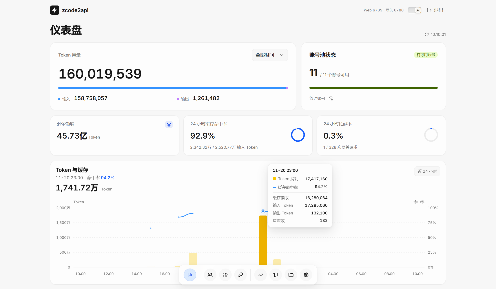
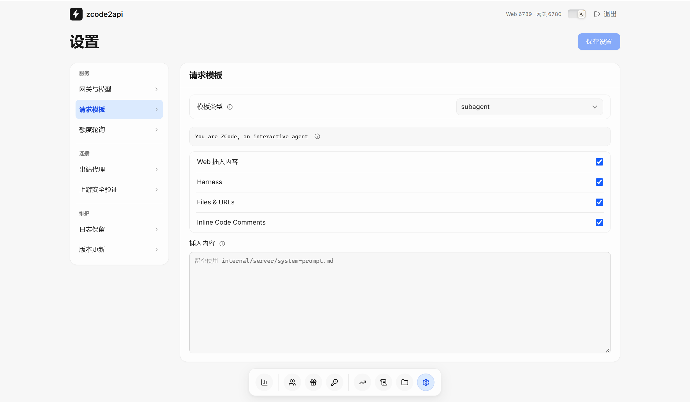

<div align="center">


# zcode2api

[简体中文](README.md) · [English](README.EN.md) · 日本語

**ZCode（智谱・Zai）「毒鸡蛋」リバースプロキシ。無料アカウントのリトライ、カード取得、複数アカウント管理をゲートウェイに任せられます。**

[](https://go.dev/)
[](#クイックスタート)
[](#クイックスタート)
[](LICENSE)

[スクリーンショット](#スクリーンショット) · [クイックスタート](#クイックスタート) · [クライアント設定](#クライアント設定) · [設定ガイド（中国語）](docs/configuration.md) · [変更履歴（中国語）](CHANGELOG.md) · [免責事項（中国語）](SECURITY.md)

</div>

zcode2api は ZCode の無料アカウント向けリバースプロキシゲートウェイです。複数アカウントの振り分けとカードの自動取得に対応し、OpenAI Chat Completions、OpenAI Responses、Anthropic Messages（推奨）を利用できます。

管理画面の「设置 → 请求模板」（設定 → リクエストテンプレート）で `subagent` を選ぶと、ゲートウェイは ZCode の既定テンプレートに含まれるネットワークセキュリティの指示を省いたサブエージェント用のシステムテンプレートに切り替わります。「Web 插入内容」（プロンプトの挿入）を有効にしてカスタムプロンプトを入力し、保存すると、転送リクエストに反映されます。

## スクリーンショット

<table>
  <tr>
    <td width="50%"></td>
    <td width="50%"></td>
  </tr>
</table>

### `subagent` リクエストの例

プロンプトの変更は、ゲートウェイが転送するクライアントリクエストに適用されます。コンテンツ審査、リスク管理、アカウントの措置は上流サービスが独自に行います。サービスの利用規約に従ってください。悪用によってアカウントが停止される場合があり、その結果は利用者自身の責任となります。

<table>
  <tr>
    <td width="50%"></td>
    <td width="50%"></td>
  </tr>
</table>

## クイックスタート

| 利用方法 | Go は必要？ | 説明 |
| --- | --- | --- |
| 完全なリリースパッケージ | 不要 | ビルド済みのプログラムを展開して実行 |
| ソースから実行（Windows / Linux / macOS） | Go 1.26+ | Windows の起動スクリプトが自動ビルド |
| Docker Compose | 不要 | Docker Compose が必要。Docker でビルド・実行 |

### ビルド済み実行ファイル

[Releases](https://github.com/7sen1ot/zcode2api/releases) から環境に合う完全なリリースパッケージ（`Source code` 以外）をダウンロードし、展開先のルートで実行します。

Windows（PowerShell）：

```powershell
.\zcode2api.exe --root .
```

Linux / macOS：

```sh
chmod +x ./zcode2api
./zcode2api --root .
```

### ソースから実行

Go 1.26+ をインストールし、Git でソースを取得します。**Code → Download ZIP** からダウンロードして展開することもできます。

```sh
git clone https://github.com/7sen1ot/zcode2api.git
cd zcode2api
```

Windows では、プロジェクトのルートで PowerShell を使い、自動ビルドしてバックグラウンドで実行します。

```powershell
powershell -NoProfile -ExecutionPolicy Bypass -File .\scripts\start.ps1  # 起動
powershell -NoProfile -ExecutionPolicy Bypass -File .\scripts\stop.ps1   # 停止
```

各環境で `go run . --root .` によるフォアグラウンド実行も可能です。`Ctrl+C` で停止します。

### Docker Compose

Docker Compose をインストールし、ソースを取得してプロジェクトのルートで実行します。

```sh
docker compose build
docker compose up -d
```

SDK 検証を利用する場合は [Docker の検証ランタイム（中国語）](docs/network.md#docker)を参照してください。サブスクリプション型プロキシノードには `--build-arg PROXY_RUNTIME=1`、grammar 検証には `--build-arg GRAMMAR_RUNTIME=1` を追加してください。

### アクセスと設定

管理画面：[http://127.0.0.1:6789](http://127.0.0.1:6789)。初期管理パスワードは `data/admin-password.txt` にあります。アカウント、設定、ログを保存する `data/` ディレクトリは保持してください。

管理画面で設定を変更するか、`config.example.json` を `config.json` にコピーします。管理画面の設定が優先されます。

## クライアント設定

1. 管理画面の「账号」（アカウント）でアカウントを追加し、OAuth 認証を完了します。
2. 「密钥」でゲートウェイの API キーを作成します。
3. クライアントに以下を設定します。

| 項目 | 値 |
| --- | --- |
| OpenAI Base URL | `http://127.0.0.1:6780/v1` |
| Anthropic Base URL | `http://127.0.0.1:6780` |
| API キー | 管理画面で作成したゲートウェイのキー |
| モデル | 例：`glm-flash`。利用可能なモデルは `/v1/models` を参照 |

リクエスト例。`YOUR_API_KEY` をゲートウェイのキーに置き換えてください。

```sh
curl http://127.0.0.1:6780/v1/chat/completions \
  -H "Authorization: Bearer YOUR_API_KEY" \
  -H "Content-Type: application/json" \
  -d '{"model":"glm-flash","messages":[{"role":"user","content":"こんにちは"}]}'
```

## 詳細ドキュメント

| ドキュメント | 内容 |
| --- | --- |
| [設定とリトライ（中国語）](docs/configuration.md) | パラメーターと環境変数、バージョン更新、利用枠の更新、カードの定時取得、アカウントの振り分け、ログ |
| [プロキシとセキュリティ検証（中国語）](docs/network.md) | ノードの選択と切り替え、[SDK 検証](docs/network.md#安全验证)、チケット管理、手動検証、[エラーコード](docs/network.md#故障排查) |
| [プロトコル互換性（中国語）](docs/protocol-compatibility.md) | ツール呼び出し、grammar 検証、システムプロンプトの重複除去、指示変換の制限 |

## 参考資料

- フロントエンド UI は [workbuddy-manager](https://github.com/ithtelab/workbuddy-manager)、[Leibox](https://leibox.pantoria.cn/components)、[Board UI](https://www.boardui.com/zh-hans/components) を参考にしています。
- 組み込みのジェイルブレイク用プロンプトは [kimik3.1.md](https://github.com/togg53192-cmd/jailbreaks/blob/main/Moonshot%20AI/kimik3.1.md) と [洺熙师傅の『巴别语』](https://mp.weixin.qq.com/s/WQohsXHbB8dUJisEpfm22g) を参考にしています。

## コントリビューションガイド

**Issue** での不具合報告や改善提案、**Pull Request（PR）** を通じたプロジェクトの開発・改善への参加を歓迎します。

**参加方法：**

1. このリポジトリを **Fork** し、新しい開発用ブランチを作成します。
2. **変更をコミット**し、コードが読みやすく、規約に沿っていることを確認します。必要に応じて説明を補足してください。
3. **PR を作成**し、変更内容と目的を説明して、レビューとマージを待ちます。

バグの修正、機能の改善、ドキュメントの整備など、どのような貢献にも感謝します。

本プロジェクトが役に立ったら、ぜひ **Star** を付けてください。継続的なメンテナンスと開発の励みになります！

## セキュリティと免責事項

本プロジェクトは非公式であり、ZCode、智谱、Z.ai、BigModel との提携関係や、これらによる推奨はありません。自身が所有するか、明示的な利用許可を得たアカウントのみを接続し、第三者サービスの利用規約を守ってください。

データディレクトリにはデータベース、マスターキー、管理パスワード、および平文で保存されている可能性のある Cookie が含まれます。アクセスを制限し、バックアップを適切に保護してください。

上流の API、キャンペーン、利用枠、アカウント制限は変更される場合があります。リトライや SDK 検証はリクエストの成功を保証しません。本プロジェクトは [Apache License 2.0](LICENSE) で公開され、ソフトウェアは「現状のまま」提供されます。保証の否認および責任制限は、ライセンス第 7 条・第 8 条と適用法に従います。詳しくは[免責事項（中国語）](SECURITY.md)を参照してください。
