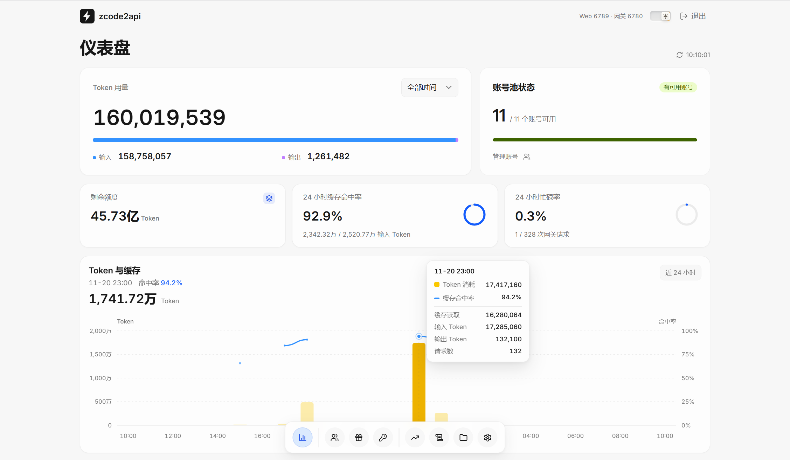
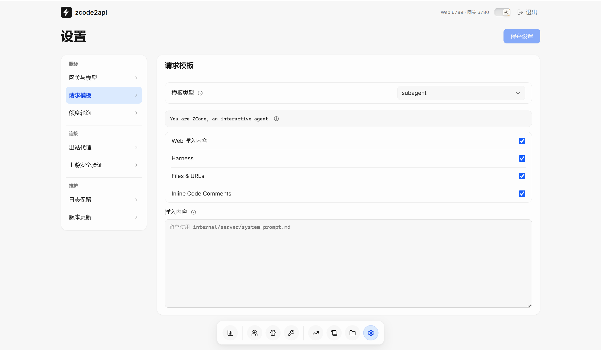

<div align="center">


# zcode2api

简体中文 · [English](README.EN.md) · [日本語](README.JP.md)

**ZCode(智谱、Zai）毒鸡蛋反代，让免费账号的重试、领卡和多账号管理交给网关。**

[](https://go.dev/)
[](#快速开始)
[](#快速开始)
[](LICENSE)

[界面预览](#界面预览) · [快速开始](#快速开始) · [接入客户端](#接入客户端) · [配置说明](docs/configuration.md) · [更新记录](CHANGELOG.md) · [免责声明](SECURITY.md)

</div>

zcode2api 是面向 ZCode 免费账号的反向代理网关，支持多账号调度和自动领卡。兼容 OpenAI Chat Completions、OpenAI Responses 和 Anthropic Messages（推荐）。

在控制台「设置 → 请求模板」中选择 `subagent`，网关会切换到子代理系统模板，省略 ZCode 默认模板中的网络安全提示段落。开启「Web 插入内容」，填写自定义提示词并保存，即可将其注入转发请求。

## 界面预览

<table>
  <tr>
    <td width="50%"></td>
    <td width="50%"></td>
  </tr>
</table>

### `subagent` 请求示例

提示词调整作用于网关转发的客户端请求。内容审核、风控和账号处置由上游服务端独立执行。请遵守平台服务条款，滥用可能导致账号封禁，相关后果由使用者自行承担。

<table>
  <tr>
    <td width="50%"></td>
    <td width="50%"></td>
  </tr>
</table>

## 快速开始

| 使用方式 | 需要 Go？ | 说明 |
| --- | --- | --- |
| Releases 完整发行包 | 不需要 | 下载已编译的程序，解压即可运行 |
| Windows / Linux / macOS 源码运行 | Go 1.26+ | Windows 启动脚本自动编译源码 |
| Docker Compose | 不需要 | 需安装 Docker Compose，由 Docker 构建和运行 |

### 可执行文件

从 [Releases](https://github.com/7sen1ot/zcode2api/releases) 下载对应平台的完整发行包（非 `Source code`），解压后在根目录运行：

Windows（PowerShell）：

```powershell
.\zcode2api.exe --root .
```

Linux / macOS：

```sh
chmod +x ./zcode2api
./zcode2api --root .
```

### 源码运行

安装 Go 1.26+，通过 Git 获取源码；也可下载 **Code → Download ZIP** 并解压：

```sh
git clone https://github.com/7sen1ot/zcode2api.git
cd zcode2api
```

Windows 在项目根目录使用 PowerShell，自动编译并后台运行：

```powershell
powershell -NoProfile -ExecutionPolicy Bypass -File .\scripts\start.ps1  # 启动
powershell -NoProfile -ExecutionPolicy Bypass -File .\scripts\stop.ps1   # 停止
```

各平台均可用 `go run . --root .` 前台运行，按 `Ctrl+C` 停止。

### Docker Compose

安装 Docker Compose，获取源码后在项目根目录执行：

```sh
docker compose build
docker compose up -d
```

需要 SDK 验证时，见 [Docker 验证运行时](docs/network.md#docker)。节点订阅代理可加 `--build-arg PROXY_RUNTIME=1`，grammar 校验可加 `--build-arg GRAMMAR_RUNTIME=1`。

### 访问与配置

控制台：[http://127.0.0.1:6789](http://127.0.0.1:6789)，默认管理密码见 `data/admin-password.txt`。请保留存放账号、设置和日志的 `data/` 目录。

配置可在 Web 中修改，或复制 `config.example.json` 为 `config.json`；Web 设置优先。

## 接入客户端

1. 在控制台「账号」中添加账号并完成 OAuth 授权。
2. 在「密钥」中新建网关 API 密钥。
3. 在客户端填写以下参数：

| 参数 | 值 |
| --- | --- |
| OpenAI Base URL | `http://127.0.0.1:6780/v1` |
| Anthropic Base URL | `http://127.0.0.1:6780` |
| API Key | 控制台生成的网关密钥 |
| 模型 | 例如 `glm-flash`；可用模型见 `/v1/models` |

请求示例，将 `YOUR_API_KEY` 替换为网关密钥：

```sh
curl http://127.0.0.1:6780/v1/chat/completions \
  -H "Authorization: Bearer YOUR_API_KEY" \
  -H "Content-Type: application/json" \
  -d '{"model":"glm-flash","messages":[{"role":"user","content":"你好"}]}'
```

## 详细文档

| 文档 | 内容 |
| --- | --- |
| [配置与重试](docs/configuration.md) | 参数与环境变量、版本更新、额度刷新、定时领卡、调度和日志 |
| [代理与安全验证](docs/network.md) | 节点选择与切换、[SDK 验证](docs/network.md#安全验证)、票据管理、人工验证和[日志报错](docs/network.md#故障排查) |
| [协议兼容](docs/protocol-compatibility.md) | 工具调用、grammar 校验、系统提示词去重和指令转换限制 |

## 参考来源

- 前端 UI 参考 [workbuddy-manager](https://github.com/ithtelab/workbuddy-manager)、[Leibox](https://leibox.pantoria.cn/components) 和 [Board UI](https://www.boardui.com/zh-hans/components)。
- 内置破甲提示词参考 [kimik3.1.md](https://github.com/togg53192-cmd/jailbreaks/blob/main/Moonshot%20AI/kimik3.1.md) 和[洺熙师傅的《巴别语》](https://mp.weixin.qq.com/s/WQohsXHbB8dUJisEpfm22g)。

## 贡献指南

欢迎通过 **Issue** 反馈问题、提出建议，也欢迎通过 **Pull Request（PR）** 参与项目开发与完善。

**参与贡献：**

1. **Fork** 本仓库，并创建新的开发分支。
2. **提交改动**，确保代码清晰、规范，必要时补充说明。
3. **发起 PR**，描述改动内容及目的，等待审核与合并。

无论是修复 Bug、优化功能，还是完善文档，每一份贡献都值得感谢。

如果本项目对你有所帮助，欢迎点亮一个 **Star**，这也是对项目持续维护与发展的支持！

## 安全与免责

本项目为非官方项目，与 ZCode、智谱、Z.ai、BigModel 无隶属或背书关系。仅接入本人拥有或已获明确授权的账号，并遵守第三方服务条款。

数据目录包含数据库、主密钥、管理密码及可能明文保存的 Cookie，应限制访问并妥善备份。

上游接口、活动、额度和账号限制可能变化，重试与 SDK 验证不保证请求成功。项目按 [Apache License 2.0](LICENSE) 开源，软件按“现状”提供，担保免责与责任限制以许可证第 7、8 条及适用法律为准。完整声明见[免责声明](SECURITY.md)。
